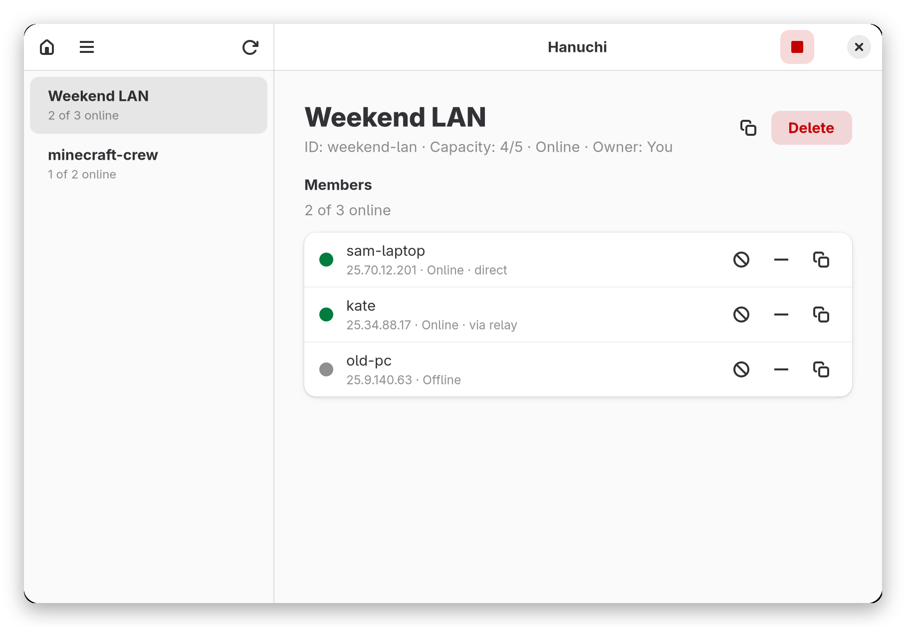
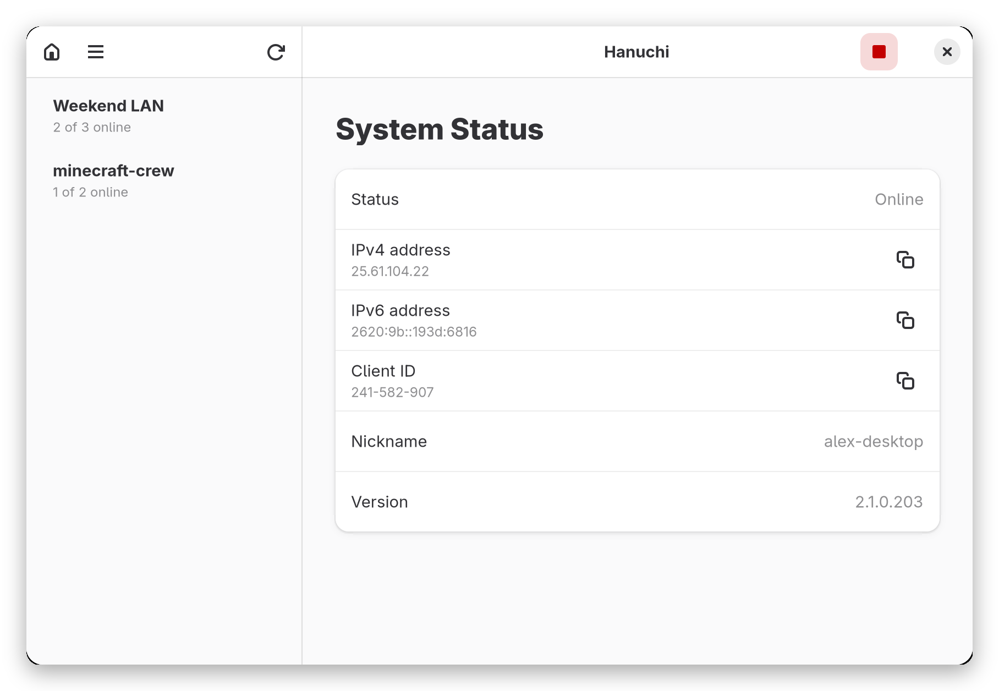
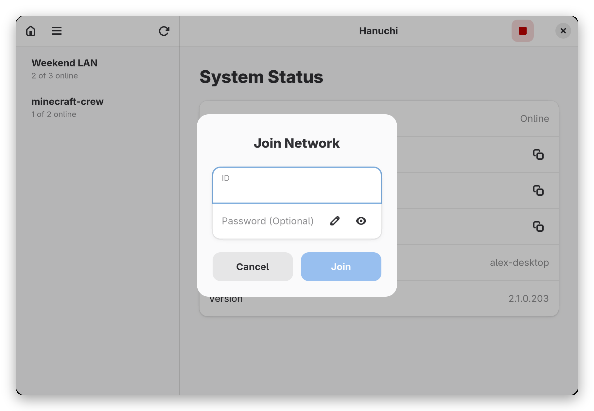
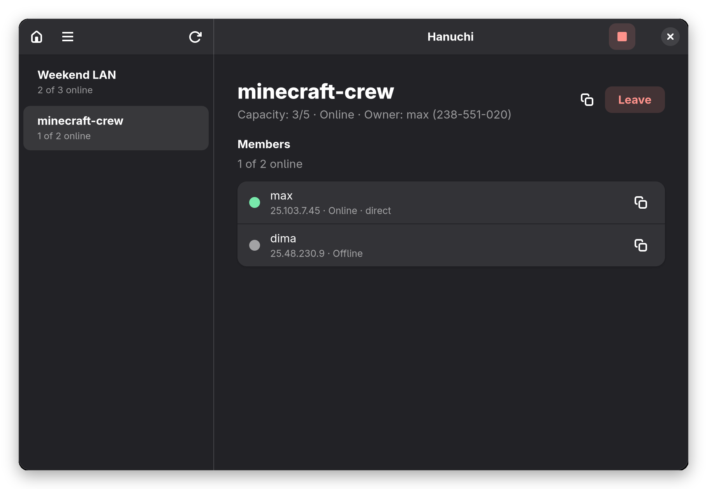

# Hanuchi


A small GTK4/Libadwaita frontend for LogMeIn Hamachi on Linux. It shows your networks and who is online in them, and lets you join, create and manage networks without the terminal.

<p align="left">
  <a href="https://github.com/Advnirr/hanuchi/releases">
    
  </a>
  <a href="https://aur.archlinux.org/packages/hanuchi">
    
  </a>
  <a href="https://github.com/Advnirr/hanuchi/actions/workflows/checks.yml">
    
  </a>
  <a href="https://github.com/Advnirr/hanuchi/blob/main/LICENSE">
    
  </a>
</p>

## Features
* **Networks and peers:** every network with its members, who is online, and whether the link is direct or relayed. Refreshes on its own every few seconds.
* **Moderation:** kick or ban members of networks you own, delete networks, leave the ones you joined.
* **Copy in one click:** your IPv4 and IPv6 address, client ID, network IDs and peer addresses.
* **Zero-config setup:** starts the `logmein-hamachi` service through polkit and registers the node on first launch.
* **Native:** GTK4 and Libadwaita, light and dark themes, English and Russian.

<details>
<summary><b>Screenshots</b></summary>









</details>

Screenshots are taken with `tools/screenshots/run.sh` in a clean container with stock Adwaita and made-up Hamachi data.

## Requirements
* Python 3.10+
* `logmein-hamachi` (installed and configured)
* `gtk4`, `libadwaita` (>= 1.2), `python-gobject`
* `meson`, `ninja` (build-time only)

## Installation

### Arch Linux / CachyOS / Manjaro
You can install Hanuchi using the included `PKGBUILD`:

```bash
cd pkg/
makepkg -si
```

Also you can install Hanuchi from AUR using Yay:

```bash
yay -S hanuchi
```

### Debian / Ubuntu
Download `hanuchi_<version>_all.deb` from [Releases](https://github.com/Advnirr/hanuchi/releases) and install it:

```bash
sudo apt install ./hanuchi_*_all.deb
```

### Fedora
Download the `.rpm` from [Releases](https://github.com/Advnirr/hanuchi/releases) and install it:

```bash
sudo dnf install ./hanuchi-*.noarch.rpm
```

Hamachi itself is not in the Debian or Fedora repos: install `logmein-hamachi` from [vpn.net](https://vpn.net/linux) first.

You can also build both packages with `tools/build-packages.sh`. It needs `meson`, `dpkg-deb` and `rpmbuild` and puts the files in `dist/`.

### From Source (Any Distro)
Hanuchi uses the [Meson](https://mesonbuild.com/) build system. Clone the repository and build:

```bash
git clone https://github.com/Advnirr/hanuchi.git
cd hanuchi
meson setup build --prefix=/usr
ninja -C build
sudo ninja -C build install
```

## Removal

### Arch Based Distributions
Remove using the pacman package manager.

```bash
sudo pacman -R hanuchi
```

### Debian / Ubuntu / Fedora

```bash
sudo apt remove hanuchi    # Debian / Ubuntu
sudo dnf remove hanuchi    # Fedora
```

### Built From Source
From the build directory created during installation:

```bash
sudo ninja -C build uninstall
```

## Support

If Hanuchi made Hamachi on Linux less painful, you can support continued
development directly:

**USDT** · TON network

```
UQDFela8stCZykNL2cLw2erPkzjAgSf-GLXoJuiTEmEckTNB
```

## License
MIT License.
